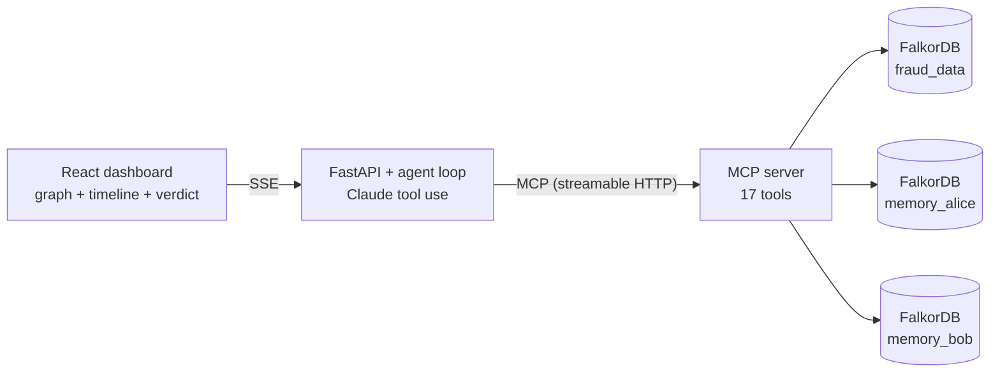

# FraudTrace

A fraud-investigation agent that **acts on connected data, remembers what it learns, and shows how it reached every answer.**
Built for  **Track 01 - Agents That Act on Connected Data**.

An analyst asks *"Which accounts are linked to flagged transaction T-9001?"*. The agent walks the graph (shared devices, IPs,
money loops), runs FalkorDB algorithms, flags the ring, opens a case, writes what it learned into the analyst's **own memory
graph**, and returns a verdict with the evidence path, the Cypher it ran and a deterministic risk score.



## Run it (one command)

```bash
cp .env.example .env            # put ONE key in .env (free: GROQ_API_KEY from console.groq.com/keys)
docker compose up --build       # first start seeds ~5k accounts / 50k transactions (about a minute)
```

Open **http://localhost:8080** (check `http://localhost:8000/api/health` - it should show your provider and `api_key_set: true`). Also: API docs `http://localhost:8000/docs`, FalkorDB Browser `http://localhost:3000`.
Reset the demo data (clears flags/cases, keeps memory): `docker compose run --rm seed python -m seed.load --force`.

No Docker? `pip install falkordblite` then `python scripts/dev_db.py` serves FalkorDB on :6379 (embedded); run
`python -m seed.load`, `uvicorn backend.main:app --port 8000` and `cd frontend && npm i && npm run dev`
(set `MCP_URL` empty and the backend spawns the MCP server over stdio itself).

## Which LLM?

The agent works with Claude or any OpenAI-compatible API; the provider is picked from whichever key is set in `.env`
(`backend/llm.py`): **Groq** (free, default model `openai/gpt-oss-120b`), **Gemini**, **OpenRouter**, **Anthropic**, or
`LLM_PROVIDER=openai_compat` with `LLM_BASE_URL`/`LLM_API_KEY`/`LLM_MODEL`. Free tiers have small per-minute token limits,
so tool results are trimmed (`MAX_RESULT_CHARS`, default 2500) and 429/malformed-tool-call responses are retried. If a model
fumbles tool calls, try another via `LLM_MODEL` (e.g. `llama-3.3-70b-versatile` on Groq).

## 2-minute demo script

1. Pick analyst **alice**. Ask: `Which accounts are linked to flagged transaction T-9001?`
2. Watch the timeline: tool choice (via MCP), multi-hop expansion, `detect_communities` / `detect_cycles`; the evidence path lights up in the graph.
3. The agent flags the ring, opens a case and saves findings. Press **Replay** to watch the path hop by hop.
4. New question in a fresh session: `What do we know about <one ring account>?` - the **What I remembered** panel shows the earlier finding and the agent builds on it.
5. Switch to **bob**: his memory is empty. Alice's findings are not visible to him.
6. Back as alice, mark a finding **false positive**: the risk score for those accounts drops (-35) and the next investigation shows it.

## What is where

| Path | Purpose |
|---|---|
| `seed/` | synthetic data generator (3 planted fraud patterns in noise) + loader; the answer key goes to `seed/out/ground_truth.json`, never into the graph |
| `shared/` | graph names/schema, the read-only Cypher **guard**, derived `PAID`/`LINKED` projections |
| `mcp_server/` | the 17 tools (`tools.py`) and the FastMCP server (`server.py`) |
| `backend/` | agent loop (`agent.py`) and FastAPI/SSE API (`main.py`) |
| `frontend/` | React + Vite + Tailwind dashboard, react-force-graph |
| `tests/` | 48 tests: data generator, guard, every tool on a live graph, MCP protocol, agent loop (scripted model), API |

## Why a graph?

The questions are about *connections*: who shares a device with whom, where money loops back, which accounts sit in the same
cluster. In SQL each hop is another join you must know to write in advance; vector search finds *similar text*, not *shared
devices*. In FalkorDB the agent follows relationships directly, runs native algorithms (WCC, PageRank, betweenness, shortest
paths) on every step, and gives each analyst an isolated graph for memory in the same database.

## Tests

```bash
pip install -r backend/requirements.txt pytest falkordblite
python scripts/dev_db.py &            # or: docker compose up -d falkordb
python -m seed.load && python -m pytest -q
```
Integration tests skip automatically when no seeded FalkorDB is reachable. The agent-loop test uses a scripted fake model, so
no API key is needed for the suite.

See **ARCHITECTURE.md** for design decisions, security choices and likely judge questions.
